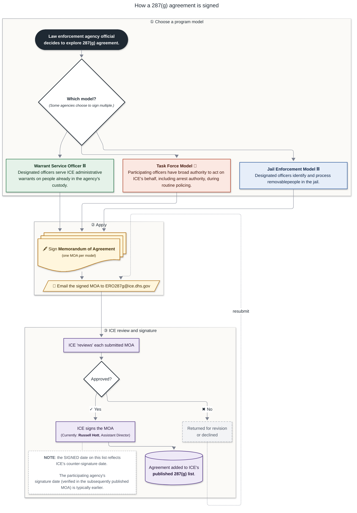

# Document Chain

ICE's 287(g) partnerships are governed and managed by a multi-layered contract that obscures important details behind the agreements’ scope of authority, financial incentives, and expectations and requirements for participating agencies.

---

## Layer 0️⃣: ICE Active Agreement List

An Excel spreadsheet available for download on [ICE's 287(g) program page](https://www.ice.gov/identify-and-arrest/287g).

**Update schedule**: irregularly, and without announcement. There are typically 1 to 3 updates published weekly.

**Versioning note:**  Each version of the spreadsheet replaces the previous one entirely. There is no changelog, no archive, and no unique identifier for any agreement.

**Tells you:** who is participating, under which model, and the ICE signature date.

> [!NOTE]
> The participating agency's signature date (i.e. the date the sheriff, police chief, etc. submitted their application to ICE), is often a day or two earlier than this listed data (when an ICE official counter-signed). The participating agency's signatory details are only verifiable in **Layer 1** (_see below_).

This list **does not** tell you scope of authority, agreement terms, money, signatories, or canceled agreement metadata.

---

## Layer 1️⃣: Memorandum of Agreement 

The document that establishes the partnership. ICE publishes a blank [fillable template](https://www.ice.gov/identify-and-arrest/287g) for each of the 3 program models active today. The templates are boilerplate legal documents, and primarily set out delegated authority, training requirements, and program-related supervision in general terms. It contains no reference to the UAC safety verification initiative or any dollar figures.

**Where to get it:** ICE's published agreement list (**Layer 0**) includes a link to the signed MOA for each agreement row.

However, these document links are typically added **2-3 weeks** *after* the agreement first appears on ICE’s spreadsheet. You’ll see ‘*link pending*’ in the MOA column for new agreements.

**Use it for:** confirming the signature date against the published list — they disagree more often than you might expect (and please let me know of any inaccuracies [in my report](https://www.tituslegaldesign.com/immigration-101/287g-report-methodology)\!)

> [!IMPORTANT]
> ICE temporarily stopped adding links to MOAs signed from **June 30, 2026** through **early November 2026**.
>
> As of the agency's most recent agreement list, published **November 10, 2026**, they've started to backfill the MOA column with links for agreements signed during this gap period. However, nearly **550** active agreements still do **_not_** have an MOA link available.

---

## Layer 2️⃣: Service Agreement

Agency-specific, signed by the sheriff, police chief, etc. and not proactively released by anyone. Likely templated, though to what degree is unclear.

This is the layer that expands the scope of the partnership beyond what the MOA describes — including work locating minors formerly in **Office of Refugee Resettlement** (ORR) custody — and sets the reporting obligations that generate the paper trail in **Layer 4**.

**Get it from:** the participating agency. The first one to surface publicly came from an Idaho sheriff's office via [***InvestigateWest*** in April 2026.](https://www.investigatewest.org/rural-idaho-sheriffs-office-got-at-least-116-000-for-helping-ice/)

---

## Layer 3️⃣: Incentives Attachment(s)

A contract 'rider' referenced by the service agreement, but not signed by either party. This is where the money is specified: a schedule of per-case payments tied to categories of completed work. 

Because it is unsigned, agencies may argue it is not a contract document. It is incorporated by reference in the service agreement.

**Get it from:** the participating agency or ICE, however unlikely, as the original publisher. The known copy surfaced through the [***Chattanooga Times Free Press*** reporting](https://www.timesfreepress.com/news/2026/jul/12/tennessee-constable-could-see-394k-from-ice/) on several Bradley County, Tennessee constables.

---

## Layer 4️⃣: Reimbursement requests + payment records

Invoices and reimbursement requests submitted to ICE, payments received. Budget amendments to accept federal funds into local accounts. Purchase orders for vehicles, body cameras, surveillance software or database access subscriptions. Officer overtime and travel records. Training certifications. Board agenda packets and minutes from the meeting where the agreement was approved.

This layer is generated locally, held locally, and may be duplicated across multiple local offices. It’s also the layer most likely to answer the question ICE has not: what ‘work’ has actually been done, and what was requested/paid for it.

**Get it from:** the participating agency, the county auditor or city comptroller, county commission or town council, state grant administrator, etc. 

---

## Layer 5️⃣: Program data and authorization files

Two categories the MOA itself says exist for each agreement:

1. **Program statistics:** § XII makes the agency responsible for tracking and maintaining accurate data on its own 287(g) program;  
2. **Authorization record:** the governing body's minutes, resolutions, and legal opinions, or the absence of them. 

**Get it from:** the agency, the government clerk, or the governing body (board, council, etc.). 

---

> [!TIP]
> **Follow the document trail:** One document can/will exist in several places, held by officials with different expectations and reporting obligations.
>
> **For example:** A sheriff who stalls on a request for their service agreement may have already sent the same document to the county commission as a board meeting agenda attachment, to the county auditor as standard financial procedure, or to the state comptroller as part of a grant application. 

---

