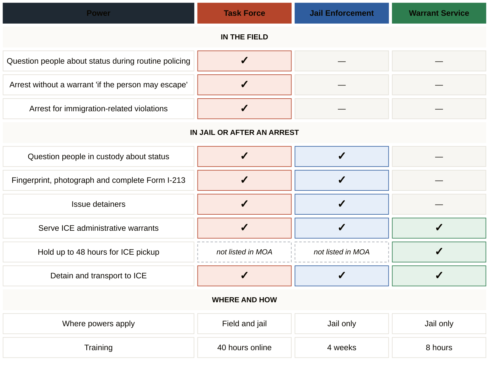

# 287(g) Program Overview

As of: **November 15, 2026**

---

## How It Works

### Program Models

## Scale

ICE reported 2,774 signed Memoranda of Agreement on its list of active agencies published **November 10th, 2026**. That list contains **2,390** unique law enforcement agencies, as some agencies hold two or three agreements across the program's three models.

In January 2025, that figure was **135**\. The expansion is overwhelmingly concentrated in the Task Force Model — the version that places immigration enforcement authority into routine street policing, and the version that was suspended in 2012 after federal findings of racial profiling. It’s also the version that’s now tied to a range of financial incentives for participating agencies.

---

## **Money**

Before October 2025, DHS only covered training costs and limited software expenses related to agencies’ participation in the program. The One Big Beautiful Bill Act (OBBBA) changed that, and ICE began marketing vehicle grants, technology subscriptions, officer payroll and overtime, and quota-based bonuses to Task Force partners.

For more on the financial incentives involved, see ‘[The Money]()’ section.

> [!NOTE]
> The original DHS announcement re: 287(g) financial reimbursement incentives, posted **September 02, 2025**, appears to have been removed in July 2026, though you can view the [**Wayback Machine** archived version here](https://web.archive.org/web/20260710162413/https://www.dhs.gov/news/2025/09/02/dhs-announces-new-reimbursement-opportunities-state-and-local-law-enforcement).

---

## **Capacity and oversight**

DHS said in [September 2025](https://web.archive.org/web/20260714100549/https://www.dhs.gov/news/2025/09/02/dhs-announces-new-reimbursement-opportunities-state-and-local-law-enforcement) that the agency had trained or was training more than **10,000** officers under the Task Force Model of the 287(g) program, while [reducing training requirements](https://forumtogether.org/article/explainer-training-under-the-revived-287g-task-force-model/). Meanwhile, the agency's expansion of supervisory \+ vetting capacity has moved far slower than the program’s real-world expansion would otherwise indicate or require.  

**See also:**

[DHS Inspector General announces pending investigations into ICE, CBP \| Immigration Policy Tracking Project](https://immpolicytracking.org/policies/dhs-inspector-general-launches-investigations-into-ice-cbp/#/tab-policy-documents) (February 2026\)

[Letter from Ranking Member Peters to DHS General Counsel \- Committee on Homeland Security & Governmental Affairs](https://www.hsgac.senate.gov/library/files/letter-from-ranking-member-peters-to-dhs-general-counsel/) (March 2026\) 

---

## **Legal pressure and local accountability**

The program is being challenged on multiple fronts, including civil rights litigation over stops and detention, [public records battles \+ litigation](#notable-/-ongoing-litigation), and challenges to whether officials at participating agencies even had authority to sign up.

> [!CAUTION]
> ICE publishes the list of active 287(g) agreements as a snapshot record via downloadable Excel spreadsheet on [this page](https://www.ice.gov/identify-and-arrest/287g), with each update replacing its predecessor. Any figure is true only for the day it was captured, and agreements disappear without notice.

---
